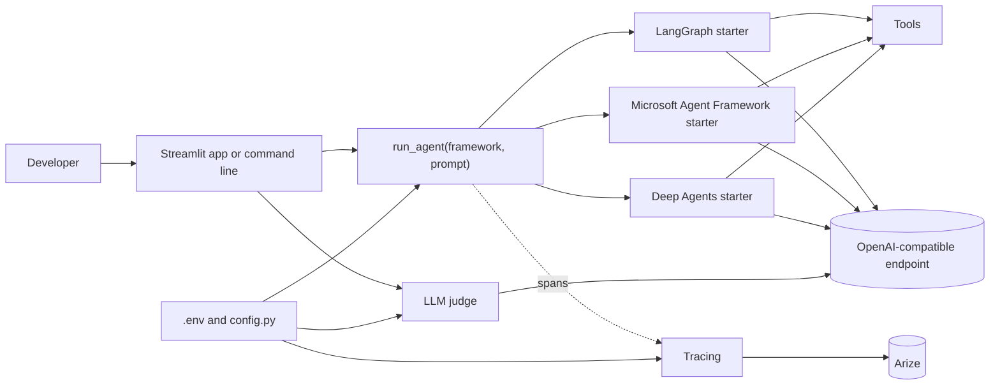

# Architecture

The starter is small on purpose. Every piece has one job, and each team builds
its capstone by replacing or extending a piece.

## How a prompt flows



1. The app or the command line calls `run_agent(framework, prompt)`.
2. `run_agent` checks the settings, turns tracing on, and opens one root span for the run.
3. The chosen framework module runs the prompt. The model may call tools.
4. The result comes back in the same shape for every framework: text, tool calls, latency, trace ID.
5. The judge grades the answer when asked.

## The pieces

| Piece | File | What to change for your capstone |
| --- | --- | --- |
| Settings | `src/bootcamp/config.py` | Add a field for each new setting, and the matching line in `.env.example`. |
| LLM client | `src/bootcamp/llm.py` | Rarely. It already accepts any OpenAI-compatible endpoint. |
| Tools | `src/bootcamp/tools.py` | Replace the two samples with your tools. |
| Agents | `src/bootcamp/agents/` | Grow `maf_agent.py` (the default) into your agent, or keep an optional starter instead. |
| Tracing | `src/bootcamp/observability.py` | Rarely. Add span attributes for your own steps if you need them. |
| Evals | `src/bootcamp/evals/judge.py`, `run.py` | Add judges for your rubric. Replace the golden set. |
| App | `app/streamlit_app.py` | Build your demo UI. |
| Mock LLM | `src/bootcamp/mock_llm.py` | Add canned behavior for your own tools so the tests stay offline. |

## The LLM endpoint

The starter talks to one OpenAI-compatible endpoint, set by three values in `.env`:
`OPENAI_BASE_URL`, `OPENAI_API_KEY` and `OPENAI_MODEL`. A LiteLLM proxy in front
of a cloud model fits this shape, and so does the OpenAI API itself.

All three frameworks use the Chat Completions API through that endpoint:

- Microsoft Agent Framework uses `OpenAIChatCompletionClient` on top of
  `make_async_openai_client()` from `llm.py`.
- LangGraph and Deep Agents use `ChatOpenAI` from `make_chat_model()` in `llm.py`.

To move to another gateway or model, change `.env`. No code changes.

## The three starters

Each module exposes `run(prompt, settings)` and returns the final text.

| Module | Shape | Grow it by |
| --- | --- | --- |
| `langgraph_agent.py` | An explicit graph: a model node, a tool node and the edges between them | Adding nodes and branches, a checkpointer for memory, an interrupt for human approval |
| `maf_agent.py` | One agent with instructions and tools | Adding agents, connecting them in a workflow, attaching MCP tools, adding middleware for approvals |
| `deep_agent.py` | A planning agent with a to-do list, a working file system and sub-agents | Defining sub-agents with their own prompts and tools |

Microsoft Agent Framework is the default (`AGENT_FRAMEWORK=maf`). LangGraph and
Deep Agents are optional. To drop one, delete its module and remove its line
from `FRAMEWORKS` in `src/bootcamp/agents/__init__.py`. The command line, the
app, `doctor` and the tests follow `FRAMEWORKS`, so nothing else needs to change.
You can also remove its packages from `requirements.txt` (Deep Agents needs the
LangGraph and LangChain packages), then run `python scripts/refresh_constraints.py`.

## Tools

A tool is a plain Python function with type hints and a docstring. All three
frameworks accept that directly. The `@recorded` decorator logs each call so
the app can show which tools ran.

```python
@recorded
def lookup_order(order_id: Annotated[str, "The order number"]) -> str:
    """Return the status of an order."""
    ...
```

Add the function to `SAMPLE_TOOLS` in `tools.py`, or pass your own list to the agent.

Keep hard rules in the tool's code. A prompt can ask the model to follow a
rule, but only code can enforce it.

## Tracing

`setup_tracing()` runs once per process and builds one OpenTelemetry tracer provider.

- LangGraph and Deep Agents are traced by the OpenInference LangChain instrumentor.
- Microsoft Agent Framework emits its own OpenTelemetry spans. A span processor
  converts them to the OpenInference format that Arize reads.
- `run_agent` wraps each run in a root span, so one run is one trace. The trace
  ID is shown in the app and printed by the command line.

Tracing is off until `ARIZE_SPACE_ID` and `ARIZE_API_KEY` are set.
`python -m bootcamp doctor` sends one test span and reports whether Arize accepted it.
Spans travel over gRPC by default. Set `ARIZE_TRANSPORT=http` on a network that blocks gRPC.

## Evals

`judge.py` builds LLM-as-judge evaluators with the Arize Phoenix evals library.
A judge is a prompt template, a set of labels and a score for each label. The
judge model is reached through the same endpoint as the agent.

`python -m bootcamp eval` runs every row of a golden set through the agent,
grades each answer, prints a table, and saves a CSV in `evals/results/`.
Use `--min-pass-rate 0.8` to make the command fail below a target.

The judge asks the model for structured output. Use a judge model that supports
it, and set `OPENAI_JUDGE_MODEL` if that differs from the agent's model.

## Tests

The tests start the mock LLM on a free local port and point every setting at
it. They cover the settings, the tools, each framework, tracing, the judge, the
checks and the app. They need no key and no network, so they run the same on a
laptop and in CI.
